# Education App

**CSC457 Mobile App Development — Project 2** · Holy Spirit University of Kaslik (USEK)

A cross-platform student app built with **React Native (Expo)** and **Firebase**. Students see their courses and deadlines, **submit assignments with photos** (and edit or delete their submission), get **reminders** before each deadline, and **practice for their quizzes** with questions from a public web API.

> Screenshots below are phone-size (390 × 844) renders of the app's real screens with sample data.

<table>
  <tr>
    <td align="center">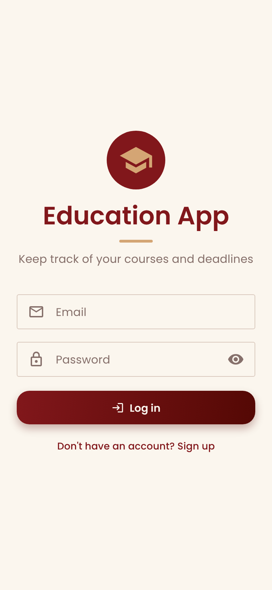<br/><sub>Login</sub></td>
    <td align="center">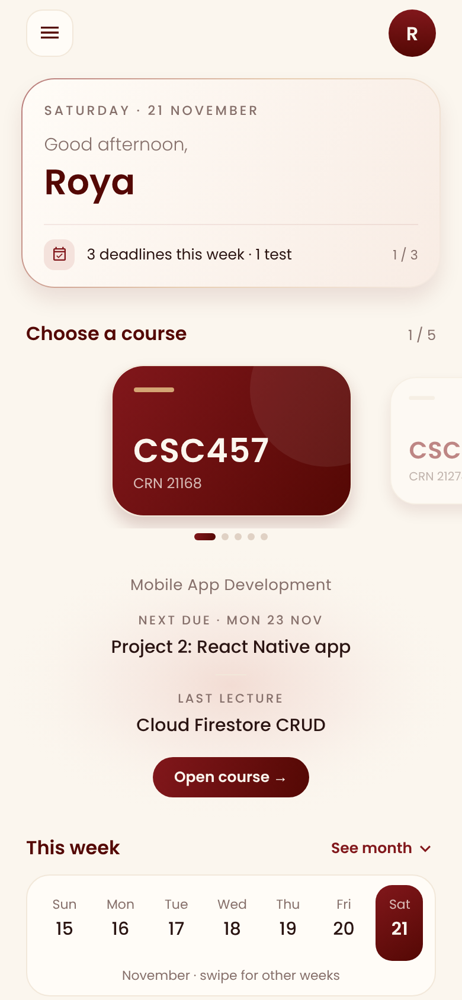<br/><sub>Home</sub></td>
    <td align="center">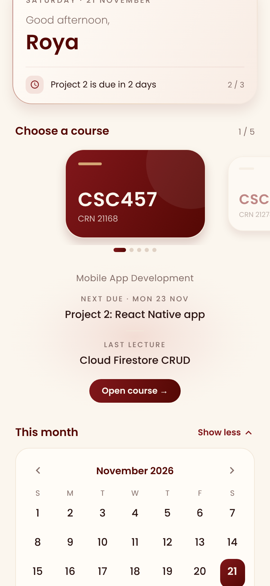<br/><sub>Home · calendar</sub></td>
    <td align="center">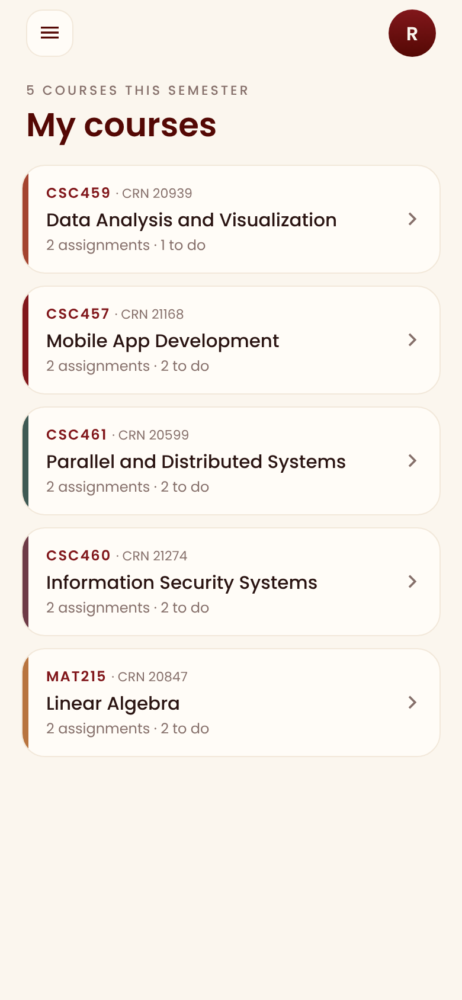<br/><sub>Courses</sub></td>
  </tr>
  <tr>
    <td align="center">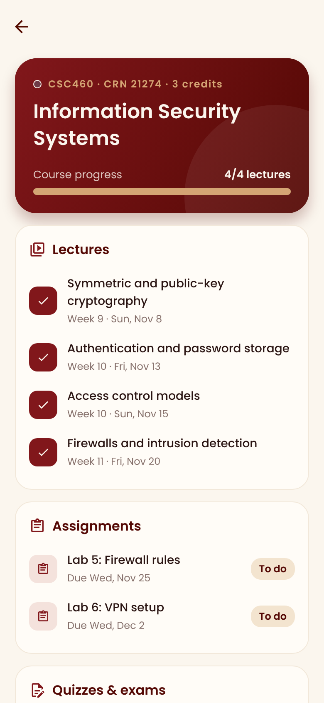<br/><sub>Course page</sub></td>
    <td align="center">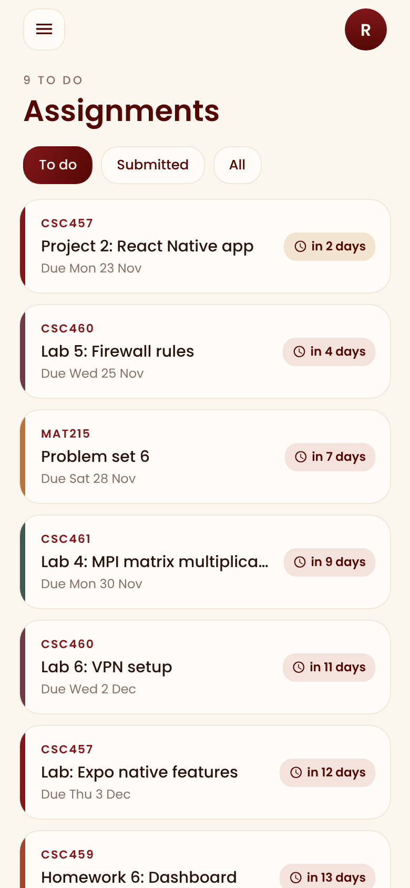<br/><sub>Assignments</sub></td>
    <td align="center">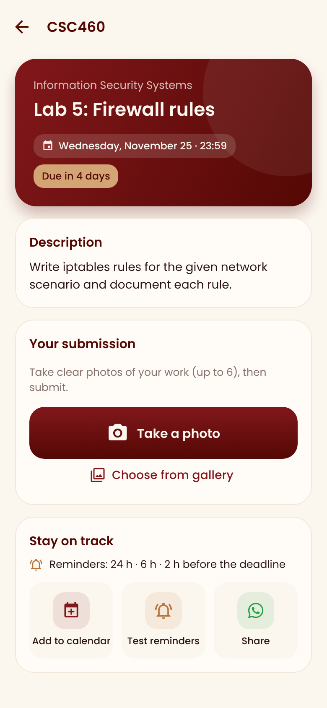<br/><sub>Assignment (to do)</sub></td>
    <td align="center">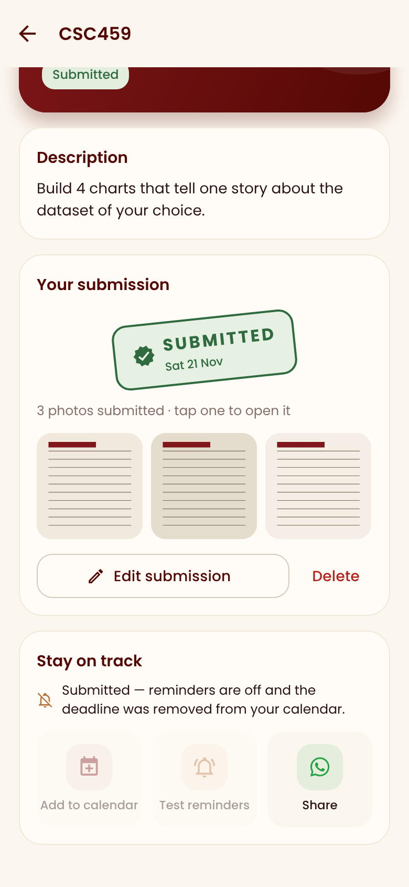<br/><sub>Submitted</sub></td>
  </tr>
  <tr>
    <td align="center">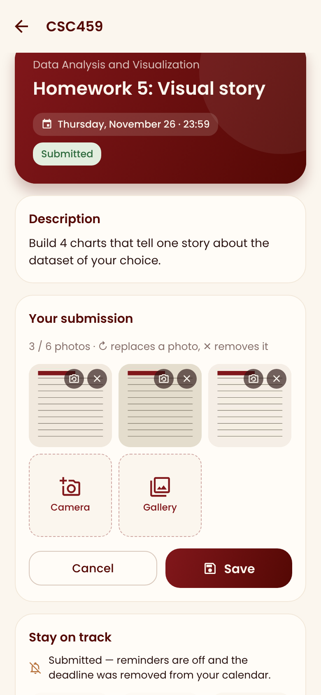<br/><sub>Edit submission</sub></td>
    <td align="center">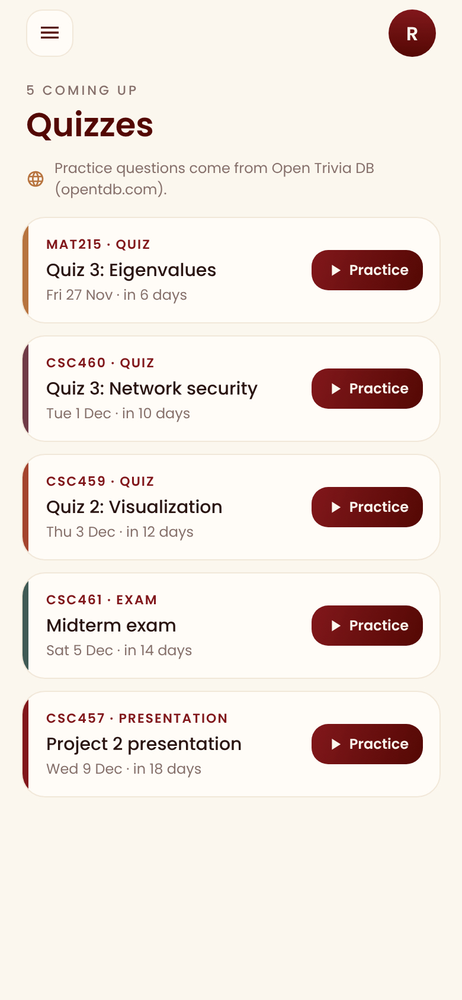<br/><sub>Quizzes</sub></td>
    <td align="center">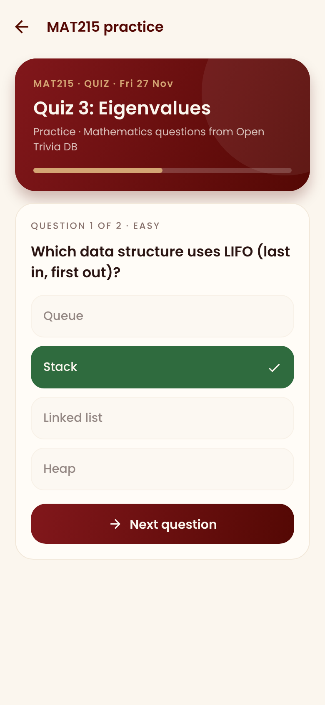<br/><sub>Quiz practice</sub></td>
    <td align="center">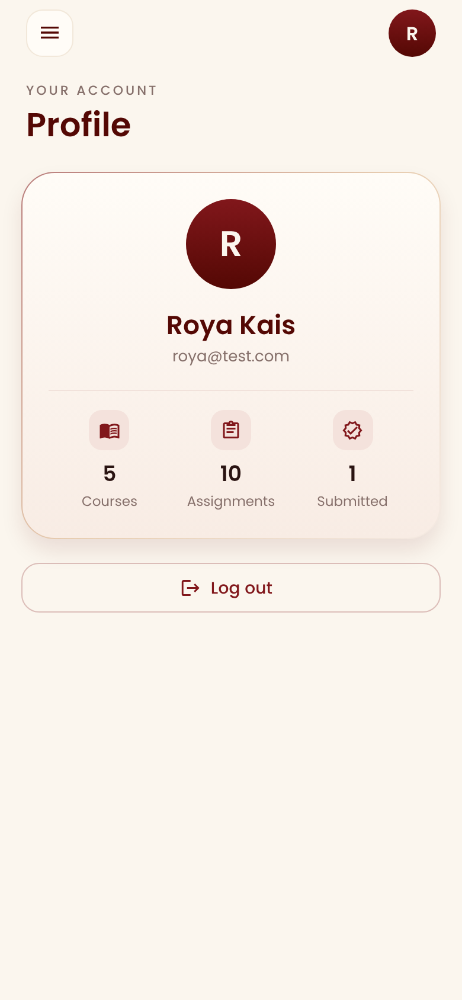<br/><sub>Profile</sub></td>
  </tr>
</table>

---

## Project requirements

| Requirement | How the app does it |
|---|---|
| Modern design with **React Native Paper** | Paper components with a custom theme (maroon `#540804`, burgundy `#81171B`, cream `#FBF6EE`) and the **Poppins** font |
| **Multiple screens** | Login, Register, Home, Courses, Course page, Assignments, Assignment page, Quizzes, Quiz practice, Profile |
| **React Navigation**: Stack, Tab, Drawer | **Drawer** (Home, Profile, Log out) → **Bottom tabs** (Home, Courses, Assignments, Quiz) → a **Stack** in each tab (e.g. Course → Assignment → Quiz). Login → Register is also a stack. |
| **CRUD operations** | **Submissions**: the student **creates** a submission with photos, **reads** it, **updates** it (add / remove / replace photos) and **deletes** it |
| **Firebase database** (backend-as-a-service) | **Cloud Firestore**: `users`, `courses`, `assignments`, `submissions` — read live with `onSnapshot` |
| **Firebase authentication** | Email/password **register, login, logout** (Firebase Auth, stays logged in with AsyncStorage) |
| **At least 4 native features** | **6**: camera, vibration, calendar, notifications, share to WhatsApp, local storage (see below) |
| **One public web API** | **Open Trivia DB** — every quiz/exam in the app can be practiced with 10 questions |

## Features

- **Home** — welcome card with the student's name and a rotating update line ("2 deadlines this week · 1 test"), a centered **course carousel** (code + CRN, nearest deadline first) whose details fade in on every swipe, and a **week calendar** that expands to the full month (dots = assignments and tests).
- **Courses** (read-only) — every student gets the 5 default CS courses. Each course page shows lectures, assignments and quizzes.
- **Assignments** (read-only) — default assignments for each course, due at 23:59, with *To do / Submitted / All* filters.
- **Submissions** (CRUD) — up to 6 photos per assignment from the camera or gallery. After submitting: a long vibration, a "SUBMITTED" stamp, reminders cancelled and the deadline removed from the phone's calendar.
- **Quizzes** — the quizzes and exams of each course, practiced with questions from Open Trivia DB (Computers or Mathematics category). The best score is saved on the phone.

## Native features (Expo SDK)

| Feature | Library | Where |
|---|---|---|
| 📷 **Camera** | `expo-image-picker` + `expo-image-manipulator` | Take photos (or pick several from the gallery) for a submission; compressed to base64 |
| 📳 **Vibration** | React Native `Vibration` + `expo-haptics` | Long vibration pattern when an assignment is submitted; taps in quizzes |
| 📅 **Calendar** | `expo-calendar` (classic API — works in Expo Go) | "Add to calendar" adds the deadline with an alarm 1 day before; removed automatically after submitting |
| 🔔 **Notifications** | `expo-notifications` | Reminders **24 h, 6 h and 2 h** before every deadline, cancelled once submitted |
| 💬 **Share to WhatsApp** | React Native `Linking` (`whatsapp://send`) + `Share` | Share an assignment's deadline with classmates |
| 💾 **Local storage** | `@react-native-async-storage/async-storage` | Remembers calendar events and best quiz scores; keeps the user logged in |

> **Notifications in Expo Go:** remote push notifications aren't available in Expo Go on Android (since SDK 53), so reminders are **local notifications** scheduled on the phone. They appear exactly like push notifications.
> For a live demo, open an assignment and tap **Test reminders**: the three reminders arrive after 5, 10 and 15 seconds (lock the phone to see them as banners).

## Firestore structure

```
users/{uid}                       name, email, createdAt
courses/{id}                      userId, title, color                                   (default, read-only)
assignments/{id}                  userId, courseId, title, description, dueDate          (default, read-only)
submissions/{uid_assignmentId}    userId, assignmentId, courseId, images[], createdAt, updatedAt   (CRUD)
```

Courses and assignments are created for each student at sign-up. A submission's id is `userId_assignmentId`, so each assignment has at most one submission per student. Photos are stored as compressed base64 strings (≈60–120 KB each, max 6) to stay under Firestore's 1 MB document limit — no paid Firebase Storage needed.

## Run the app

Requirements: **Node.js 22.13+**, the **Expo Go** app (SDK 58) on your phone, and/or **Android Studio** with an emulator.

```bash
git clone https://github.com/royakais/Education-App.git
cd Education-App
npm install
npx expo start
```

- **Phone:** scan the QR code with Expo Go (same Wi-Fi as the computer, or run `npx expo start --tunnel`).
- **Android emulator:** start a virtual device from Android Studio → Device Manager, then press **`a`** in the Expo terminal.
- If the app shows an old version: stop the server and run `npx expo start -c` to clear the cache.

**First launch:** register a new account — it gets the default courses and assignments automatically. Allow camera, calendar and notification permissions when asked.

## Project structure

```
App.js                        fonts, providers, navigation container
firebaseConfig.js             Firebase app, Auth (with AsyncStorage persistence), Firestore
src/
  navigation/AppNavigator.js  drawer → tabs → stacks
  context/AuthContext.js      register / login / logout
  services/
    courses.js                courses (read + default courses at sign-up)
    assignments.js            assignments (read + default assignments)
    submissions.js            submissions — Create / Read / Update / Delete
    trivia.js                 Open Trivia DB (public web API)
  native/                     camera, vibration, calendar, notifications, share, storage
  hooks/                      useCourses, useAssignments (live Firestore data)
  screens/
    auth/                     Login, Register
    home/                     Home
    courses/                  Courses list, Course page
    assignments/              Assignments list, Assignment page (submission CRUD)
    quiz/                     Quizzes list, Quiz practice
    ProfileScreen.js
  components/                 CourseCarousel, WeekCalendar, ScreenHeader, Gradient, SubmittedStamp, ReminderSync
  data/                       default courses, course info (lectures/quizzes), quizzes
  utils/                      dates, CRN generator
  theme.js                    colors, Poppins fonts, Paper + navigation themes
```

## Tech stack

React Native 0.88 · Expo SDK 58 · React Native Paper · React Navigation 7 · Firebase (Auth + Firestore) · Reanimated · Open Trivia DB
